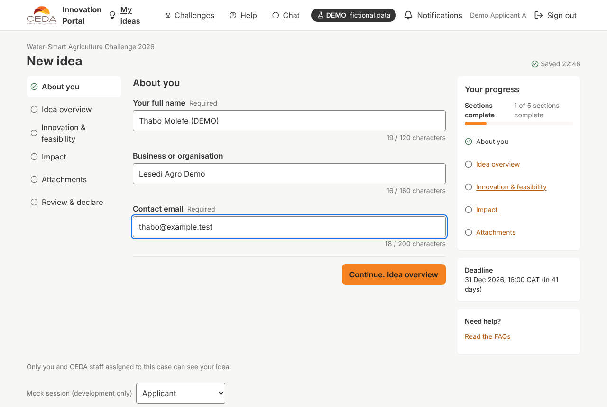
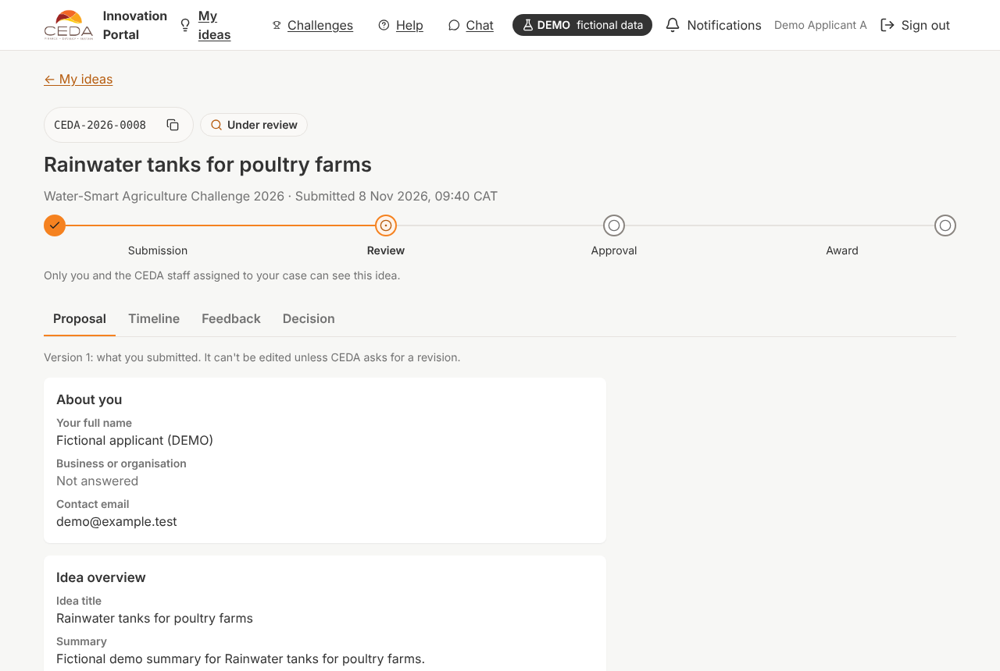
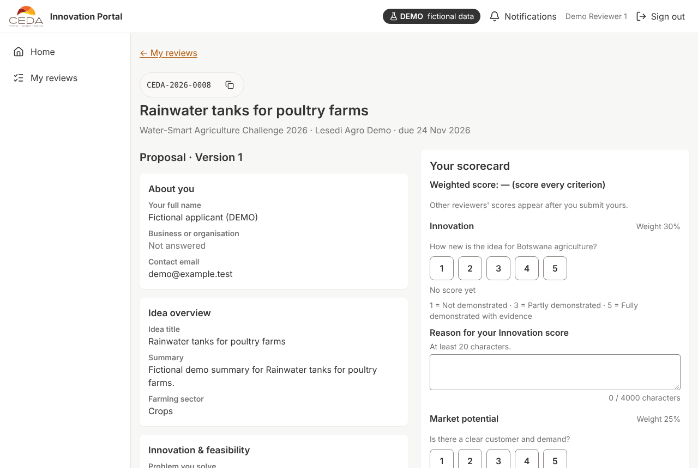
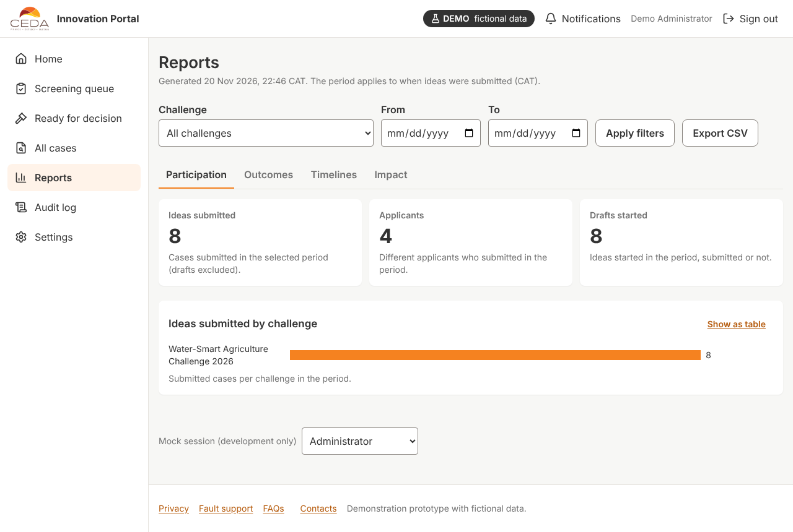

# CEDA Innovation Portal: technical proposal

**Team:** Sandra (UI/UX), Obvious (frontend), Stacey (backend and database), Sylvain (integration, testing and documentation) · **Version:** draft 1, 20 Nov 2026 · **Answers:** backlog DOC-01
**Status:** Draft for team review. It becomes final at the release (22 Nov 2026), when every **[confirm at release]** mark is resolved against the judging build. The proposal makes no claim that `docs/testing/claim-register.md` does not show as Passed.

> This is a demonstration prototype with fictional data only. It is designed with reference to Botswana's Data Protection Act, 2024; it makes no claim of compliance.

## 1. Summary

The CEDA Innovation Portal lets citizens and businesses submit innovative ideas to CEDA challenges, and lets CEDA screen, evaluate, adjudicate, fund and give feedback on them in one place. Our design goal was **one convincing, working path where nothing is faked**:

**submit → screen → two independent evaluations → revision request → version 2 → adjudication → published decision → award**

Every state change is one database transaction that also writes an audit entry, and every access rule is enforced by the database, not only hidden in the screens. Our innovation is the **Constructive Feedback Roadmap** (section 7): a revision request becomes a list of concrete tasks; the applicant answers each one in version 2; each reviewer verifies each answer. Feedback stops being a one-way rejection letter and becomes a measurable improvement loop, the opposite of a dead-end submission.

## 2. Motivation

Small businesses and innovators who apply for support often never learn why an application stalled, and organisations that run challenges lose ideas that one round of guided revision would have made fundable. For CEDA, a portal also has to protect confidential business ideas, show a fair and auditable evaluation, and work for applicants on mobile data.

So we set four principles from the brief and the research (section 3):

1. **No dead-end submissions:** every applicant can see where their idea is, and every "not yet" comes with specific, checkable feedback.
2. **Fair and independent evaluation:** reviewers declare conflicts before they see a proposal, score against a published rubric, and can't see each other's scores until they submit their own.
3. **Confidential by default, enforced on the server:** an applicant sees only their own ideas; a reviewer sees only assigned cases, and only after declaring.
4. **Usable on a phone on mobile data:** text-first pages, 360 px layouts, autosave with a device copy, and upload progress with retry.

## 3. Research

The full dated log is `docs/submission/research-log.md`. The main findings and what each changed:

| Question | What we found | What it changed |
|---|---|---|
| What must the portal do, and how is it judged? | The brief, rules and FAQ, captured as a backlog with acceptance checks and the 100-point rubric | `docs/requirements/Portal_Backlog.md`, the basis of every decision below |
| What do existing innovation-challenge platforms do well? | Reviewer conflict and confidentiality declarations before access; 1–5 scores with anchored definitions; separate approval and award; versioned submissions | Reviewer declaration (D-19); applicant declaration (D-22); separate award event (DEC-02) |
| What does the local innovation ecosystem need? | The team's ecosystem brief points to "no dead-end submissions". It marks its own feature ideas as unvalidated hypotheses, so we don't quote its statistics (D-26) | The Feedback Roadmap became the primary differentiator (D-24) |
| How does a case move? | Five public stages; approval and award as separate events; a revision returns to the stage that asked for it | Case states and transitions (blueprint §3) |
| Which hosting region serves Botswana best? | No African Supabase region exists. Measured from Gaborone on mobile data: EU Central p50 263 ms, p95 315 ms (`artifacts/phase-00/region-latency.md`) | EU Central (D-14); the Mumbai comparison was not run |
| What does the existing CEDA design contain? | A Figma Make prototype with 9 of 15 templates started; small text; white on CEDA orange is 2.59:1, below the 4.5:1 contrast minimum | CEDA palette kept, with accessible text and button colours (D-04); screens built from the written spec where no design frame existed (BCR-003) |

## 4. Design

**Users.** Nine roles, each with navigation that leads straight to its own work: applicant, screening officer, reviewer, adjudicator, administrator, support consultant, support lead, external committee member (reference and stage only, D-08) and auditor.

**Experience.**

- **Plain language and visible status:** five public stages on a timeline, and "Action required" with a deadline when CEDA asks something.
- **Forms that forgive:** autosave to the server plus a copy on the device; a completeness meter; an error summary that links to each field; a declaration on the final step.
- **Honest outcomes:** a lost reply on submit shows "Not confirmed yet" with a status check, never a false "failed". Retrying can't create a second idea.
- **Accessibility:** one main heading per page, a skip link, visible focus, labels on every field, 44 × 44 px touch targets, and contrast of at least 4.5:1. Each page is checked at 360 px and 1280 px.
- **Brand:** CEDA's colours, fonts and logo from the team's Make file (D-04), with the orange used where it meets contrast rules.

**Process.** Where a design frame existed, screens follow it; elsewhere they were built from the written specification and reviewed by the designer on staging (BCR-003). By 20 November every planned screen was built: the main journey, notifications, reports, the audit log and live chat, plus the staff home page, the administration screens (users and roles, challenges, forms and rubrics, content, chat hours), staff two-step enrolment, the committee view and side-by-side version compare. Screens without a design frame are marked Provisional until the designer has reviewed them. Design review status: **[confirm at release]**.

<p> </p>
<p> </p>

*Figure 1: the proposal form, the applicant's case view, a reviewer's scorecard (other reviewers' scores stay hidden until submission) and the reports dashboard. Demo build with fictional data.*

## 5. Architecture

```
 Browser (React SPA)  ──HTTPS──>  AWS Amplify (static hosting, security headers, CSP)
        │
        │  HTTPS: public key only; every request carries the user's session token
        ▼
 Supabase (EU Central)
   ├─ Auth: email and password, verified email, password reset, staff TOTP (MFA)
   ├─ PostgREST: READS only; Row Level Security on every table, deny by default
   ├─ RPCs (SECURITY DEFINER): ALL state changes; permission + state check + audit in one transaction
   ├─ Storage: private bucket for proposal files; 60-second signed download links via an Edge Function
   ├─ Realtime: notifications and case history, filtered by the same RLS
   ├─ Edge Functions: attachment links, staff invitations, email relay (from an outbox table)
   └─ pg_cron: scheduled maintenance (expire overdue requests, sweep missed chats, relay email)
```

**Why this shape.**

- **One place enforces the rules.** Browsers can only read, and only through RLS policies. Every change goes through a database function that checks the permission and the case state, makes the change and writes the audit entry in the **same transaction** (D-02). A screen bug can't bypass a rule, because the rule isn't in the screen.
- **Small surface.** There is no custom application server to secure, patch and scale. Supabase provides Postgres, authentication, storage and realtime as managed services.
- **Replaceable frontend.** Screens talk to typed "ports". A mock adapter lets the whole UI run with no backend for design review and tests, and a Supabase adapter talks to the real one. Only one folder may import the database client, enforced by a lint rule.

**Data model, in short.** Challenges have versioned forms and rubrics. A case (proposal) has immutable versions (V1, V2 …), files tied to a version, assignments, scorecards tied to the version they score, feedback requests with tasks, decisions (draft, then published), awards, a case history and an append-only audit trail.

## 6. Technology stack

| Layer | Choice | Why |
|---|---|---|
| Frontend | React 18, TypeScript, Vite 6, Tailwind, Radix UI, React Router 7, TanStack Query | Type safety; accessible primitives; small production bundle |
| Backend | Supabase: Postgres 17, PostgREST, Auth, Storage, Realtime, Edge Functions (Deno), pg_cron | Security rules live in the database; managed services; no server to run |
| Hosting | AWS Amplify (frontend, D-44); Supabase EU Central (backend, D-14) | HTTPS only, security headers and CSP; edge locations in South Africa; lowest measured latency |
| Tests | Vitest (frontend); pgTAP (database); Playwright (browser at 360 and 1280 px); a two-connection concurrency test | Each rule is tested at the layer that enforces it |
| Delivery | GitHub with protected `main`: 7 required checks (secret scan, lint, type-check, unit tests, build, dependency audit, database gate) | No change reaches `main` without review and green checks |

## 7. How the portal meets the brief

| Brief function | How we meet it | Evidence (claim register) |
|---|---|---|
| **Secure submission** | Private file storage; paths never contain the user's file name; type and size checked by the server; 60-second download links after an access check. Submit is one transaction (case, locked V1, reference `CEDA-2026-NNNN`, audit, notification) and is idempotent: retrying can never create a second case | C-02 Passed on hosted (link refused after 62 s); C-11 Passed (same key → same receipt; two simultaneous submits → one case) |
| **Team evaluation and adjudication** | Screening; at least two reviewers; a declaration before the proposal opens (a conflict removes the assignment); 1–5 anchored scores with a required reason; peer scores hidden until a reviewer submits; a panel with individual and weighted scores and spread; a decision recorded as a draft, then published; an award only after approval | C-03, C-10, C-12, C-05 Passed (database); C-15 partly passed (API level on the hosted project; the screens pass the same journey in a browser against the demo build; the hosted browser run is **[confirm at release]**) |
| **Stage tracking** | Five public stages on a timeline; "Action required" with a deadline; every change in an immutable case history | C-13, C-14 |
| **Role-based access** | Nine roles as data; RLS on every table, deny by default; no browser writes; nobody can grant themselves a role (refused and audited) | C-01, C-07, C-08 Passed; 11 negative tests (N1–N11) |
| **Real-time updates** | Supabase Realtime on notifications and case history, filtered by the same access rules | C-16 Passed on hosted: another applicant received 0 events |
| **Feedback** | Clarification (a reply, no new version) and revision (a new version with the Feedback Roadmap) | C-13 Passed (V1 scores kept after V2) |
| **Reporting dashboards** | Participation, outcomes and time in stage, from the case history, with CSV export | Built and tested, screens included; the CSV export guards against spreadsheet formulas in applicant text |
| **Scalability and flexibility** | New roles, permissions and rubric criteria are data, not code; challenges carry their own form and rubric versions; stateless frontend on a CDN; key lookups indexed, with the remaining hot foreign-key indexes listed for real volumes | Scaling note (section 10) |
| **Data integrity** | Versions, audit entries and history are append-only: triggers refuse change or deletion by any portal user, including administrators. Every transition is checked against the case's current state | C-06 Passed (database layer) |
| **Ease of use for every user type** | Role-specific navigation, plain language, autosave and device copy, honest "not confirmed" states, 360 px layouts | Browser checks at 360 and 1280 px; **[confirm at release]** keyboard and timed-task log |

## 8. Innovation: the Constructive Feedback Roadmap

A typical challenge portal ends a weak application with a decision and a paragraph of comments. We turn feedback into a loop:

1. A reviewer or screening officer asks for a **revision** with a list of **tasks**, for example "Add a 12-month budget" or "Name your pilot district".
2. The applicant prepares **version 2**. For each task they mark **Addressed** or **Not addressed** and explain how. The portal won't accept V2 until every task has an answer.
3. Each assigned reviewer **verifies** each task on the V2 scorecard (Verified or Not verified, with a note). Version 1's scores stay with version 1, so progress is visible and fair.
4. Reports can then show something most portals can't: how many ideas improved after feedback and reached a later stage.

It is backed by a side-by-side comparison of V1 and V2 (INN-01) and a rule-based completeness helper on the form (INN-03). **No proposal data goes to any external AI service (D-25).** All four steps are built in the screens, and the database enforces them (C-13).

## 9. Security and privacy

- **Authentication:** Supabase Auth with verified email, a 12-character minimum password, a neutral "if an account exists" recovery message, rate limits and TOTP for staff. Seeded demo staff accounts are exempt behind a setting so that judges can sign in (D-07); it is switched off for any real use.
- **Authorisation:** described in section 5, and tested from the side of the person being refused.
- **Transport and headers:** HTTPS only (HSTS), a Content-Security-Policy that allows only our origin and Supabase, `X-Frame-Options: DENY`, `nosniff`, and strict Referrer and Permissions policies. An automated browser test confirmed all six headers on the deployed staging site (24 passed, 16 Nov, E2E run 44051061592).
- **Secrets:** no credentials in the repository (a secret scan runs on every PR). The browser holds only the public key, and the service-role key never reaches it. Demo passwords come from the environment (D-17).
- **Dependencies:** an audit on every PR. One high-severity advisory affects build tooling only and doesn't ship; it is recorded with a reason (ADR-001).
- **Privacy:** purpose, access, proposed retention, processors and breach handling are described in `docs/submission/data-handling-note.md`. It is designed with reference to the Data Protection Act, 2024, with no compliance claim (D-18). Data leaves Botswana because no African Supabase region exists; this is recorded as a limitation for real use.

## 10. Evidence, testing, hosting and scale

**Testing.**

- **502 pgTAP assertions** in 13 suites, run in CI on the Supabase local stack on every database change. The latest run against the hosted project passed 493 of 493 (21 Nov, before the report reconciliation suite was added); the release run is **[confirm at release]**. **Mutation checks** confirm the tests fail when a rule is broken.
- A **two-connection concurrency test** for double submits.
- **Vitest** for the frontend logic.
- **Playwright** browser checks at 360 and 1280 px, and a security-header check against the deployed site.
- A **real-backend browser journey**: **[confirm at release]** its result.

Every claim is in `docs/testing/claim-register.md`, with its evidence and what is still Not run.

**Hosting and availability (24/7).**

- The frontend is on AWS Amplify (CDN). The backend is on Supabase EU Central.
- A scheduled keep-alive workflow and an uptime monitor alert a named person (OPS-03). **[confirm at release]** that both are running.
- After the deadline nothing is deployed without organiser approval, and any approved change is logged.
- **[confirm at release]** whether judging runs on the Supabase Free or Pro plan.

**Backup and recovery.** A restore drill took a backup of the hosted data, rebuilt a database from the migrations, loaded the data and compared every table row by row. Recovery time was 5.2 s for the demo data (C-20; the target was a PGlite stand-in). File storage is outside that drill and is listed as a gap.

**Cost (assumption, to check on the day).** Storage is about 6 GB per 1,000 ideas (3 files, 2 MB average each). Supabase Pro's included quotas cover the demo and a first real cohort; prices are quoted only with the date they were checked (runbook §1).

**Scaling path.**

- The frontend is static on a CDN.
- Postgres scales vertically first. Indexes on the hot foreign keys are listed for real volumes.
- Files sit in object storage and can move to a scheduled copy.
- The email relay is an outbox, so a slow mail provider never blocks a workflow.
- New challenges, forms, rubrics and roles need no code change.

## 11. Lessons learned

1. **Put the rule where it can't be skipped.** Enforcing access and state in the database meant screens could be built fast without each one re-implementing security, and it made the negative tests meaningful.
2. **Test the refusal, not only the success.** Most of our 502 assertions check that the wrong person or the wrong state is refused and that nothing changed. Mutation checks proved the tests can fail.
3. **Say exactly what was verified, and where.** We learned to label evidence by layer ("database", "API on the hosted project", "browser") and to write Not run and Simulated plainly. Our own reset tool, for example, showed that the database owner can pause protective triggers, so we narrowed the audit claim to "any portal user, including administrators".
4. **Small, reviewed, green pull requests.** Seven required checks and review on every PR caught real problems: function privileges, a confidential screening note visible to applicants, whitespace-only answers, and a data-loss bug in the form's first autosave, before they reached the build.
5. **Design and code in parallel.** When design frames lagged, building from the written spec with design review on staging kept the plan on time (BCR-003).

## 12. Open items at the time of writing

| Item | Status |
|---|---|
| Email sending | **Simulated:** no SMTP connected for the demo; alerts are queued and visible in the outbox |
| Malware scanning of uploads | **Deferred** |
| Retention and data-subject requests | Proposed in the data-handling note; manual, not automated |
| Region comparison with Mumbai | **Not run** |
| Restore into a full Supabase project, and file storage backup | **Not run** |
| Settings screens for the review quorum and the demo two-step exemption | **Not built:** stored settings changed by the backend team |
| Hosted browser journey result, design review, plan and contact details | **[confirm at release]** |
